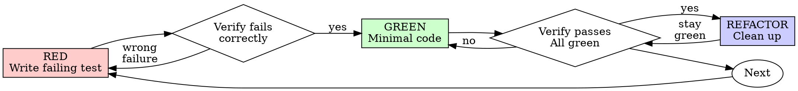

# Test-Driven Development (TDD)

## Overview

Write the test first. Watch it fail. Write minimal code to pass.

**Core principle:** If you didn't watch the test fail, you don't know if it tests the right thing.

**Violating the letter of the rules is violating the spirit of the rules.**

## When to Use

**Always:**
- New features
- Bug fixes
- Refactoring
- Behavior changes

**Exceptions (ask your human partner):**
- Throwaway prototypes
- Generated code
- Configuration files

Thinking "skip TDD just this once"? Stop. That's rationalization.

## The Iron Law

```
NO PRODUCTION CODE WITHOUT A FAILING TEST FIRST
```

Write code before the test? Delete it. Start over.

**No exceptions:**
- Don't keep it as "reference"
- Don't "adapt" it while writing tests
- Don't look at it
- Delete means delete

Implement fresh from tests. Period.

## Red-Green-Refactor



### RED - Write Failing Test

Write one minimal test showing what should happen.

<Good>
```typescript
test('retries failed operations 3 times', async () => {
  let attempts = 0;
  const operation = () => {
    attempts++;
    if (attempts < 3) throw new Error('fail');
    return 'success';
  };

  const result = await retryOperation(operation);

  expect(result).toBe('success');
  expect(attempts).toBe(3);
});
```
Clear name, tests real behavior, one thing
</Good>

<Bad>
```typescript
test('retry works', async () => {
  const mock = jest.fn()
    .mockRejectedValueOnce(new Error())
    .mockRejectedValueOnce(new Error())
    .mockResolvedValueOnce('success');
  await retryOperation(mock);
  expect(mock).toHaveBeenCalledTimes(3);
});
```
Vague name, tests mock not code
</Bad>

**Requirements:**
- One behavior
- Clear name
- Real code (no mocks unless unavoidable)

### Verify RED - Watch It Fail

**MANDATORY. Never skip.**

```bash
npm test path/to/test.test.ts
```

Confirm:
- Test fails (not errors)
- Failure message is expected
- Fails because feature missing (not typos)

**Test passes?** You're testing existing behavior. Fix test. A test that is green before the implementation is a finding, not a footnote — it is vacuous, on the wrong fixture, or testing something already built; say which before going on. The usual culprits: an empty collection (assert it is non-empty first) and shared state an earlier test switched and never restored. Or the scenario holds a second path to the right answer: a side effect of one of its steps heals the symptom (a jump that also changes which rows are drawn, so the view re-measures and re-syncs on its own). Don't just tighten the assertion — list what each step changes, and pick a scenario where only the fix can make it pass.

**Test errors?** Fix error, re-run until it fails correctly.

**Proving an existing fix red:** revert only the lines that ARE the fix — never the whole file when it also holds other uncommitted work — and read the message: it must be the defect's own failure, not a missing-function error. Set the fix aside with a copy of the file, not `git stash`: the stash is shared by every worktree of the repository, and a `; git stash pop` after a chain that failed early pops someone else's work. While another check run is in flight in the same tree, keep a red test that does not compile out of the tree until that run has passed its build stage.

**Red is an observation of each assertion, not the order two files were written in.** A test file that cannot load until the code exists (it imports what is not written yet) fails every case alike — that is not red. Prove it one of two ways: run it against a stub that compiles and does the OLD behaviour; or, once green, break the one line that makes it pass and record how many cases went red — one break per rule, by a script that applies each break, runs the narrowest test file and restores the original bytes in a `finally`. In a batch of fixes, run the batch's tests before the first fix lands and keep the output. An integration test of a NEW write path is never blocked by the path not existing: its red is "nothing reached storage". This recovers the proof for a test written first that could not be seen failing; it is not a way to write the code first — the Iron Law stands.

**A test selected by name** (`-t`, `-g`, `--grep`): confirm in the summary that it RAN ("1 failed", not "0 tests") before reading the exit code — a name holding brackets or quotes matches nothing, and the run exits 0.

**Read the red — it must name the defect's own effect.** A red from a setup step (the test could not draw its line; its own click deleted the thing it meant to test) proves nothing, and will lie again on the fixed code. Before the action, each case asserts its PREMISES — e.g. the object it acts on exists and is the one this case created, the intended tool or mode is active, nothing else is selected — and identifies what it created by a unique handle (an id), never by a count or aggregate the fixture may already satisfy. For rendered geometry, use a measurement that includes every transform in play (element rectangles include CSS zoom; an SVG's screen matrix under a CSS-zoomed ancestor may not).

**An assertion that something is ABSENT** — "gone", "not shown", "nothing written", "refused" — passes on an empty screen, on a fixture step that silently refused, and on an action that never happened. In the same test, first assert the thing was present (or that the gesture landed: its ghost, the refusal's own words), then act, then assert the absence. And judge a red run by the tests that PASSED as closely as by the ones that failed.

**A state-comparison fault** gets the pair — the case reported AND its inverse (add / remove, open / close, first / last) — with the side effects asserted too (the message shown, nothing else reset): coincidence hides the second fault in the first.

**A finding from a device-specific walk** (touch, a coarse pointer, a phone's layout): the red test mounts the real surface the walk saw and stubs the environment switch the code branches on (`matchMedia('(pointer: coarse)')`) — or is renamed to say what it proves. The re-walk of such a fix is never skipped on the strength of the unit test.

**Races:** write the losing order down as steps, and make the test force that order — hook the boundary (the storage read, the network call) and perform the competing write from inside it. Assert that the hook fired, so a green test cannot be one that never reached the race. Adding a delay and hoping is not a race test.

**A flash or a jump** lives in one painted frame: a test that waits before it asserts passes on it. Arm a `MutationObserver` before the action and measure in its callback — it runs at the microtask checkpoint, before the next rendering opportunity.

**Failure paths:** for a recovery test, inject the fault at the call you mean to fail — a stub, or a module loaded first that makes the Nth call throw — not through a platform rule (a read-only file, a lock), which faults on one operating system and not another. Where the platform's behaviour itself is the requirement, exercise it on every supported operating system instead. Then break the recovery once and watch the test go red.

**Suites that share one running fixture:** a test that changes shared state runs after every test that reads the old state, or gets a fixture of its own.

### GREEN - Minimal Code

Write simplest code to pass the test.

<Good>
```typescript
async function retryOperation<T>(fn: () => Promise<T>): Promise<T> {
  for (let i = 0; i < 3; i++) {
    try {
      return await fn();
    } catch (e) {
      if (i === 2) throw e;
    }
  }
  throw new Error('unreachable');
}
```
Just enough to pass
</Good>

<Bad>
```typescript
async function retryOperation<T>(
  fn: () => Promise<T>,
  options?: {
    maxRetries?: number;
    backoff?: 'linear' | 'exponential';
    onRetry?: (attempt: number) => void;
  }
): Promise<T> {
  // YAGNI
}
```
Over-engineered
</Bad>

Don't add features, refactor other code, or "improve" beyond the test.

**A fix guarded on an existing flag or mode:** read every place that flag is assigned before trusting its comment — a lifecycle comment is a claim. If the red test stays red, check the guard first.

**A guard that suppresses input** (a double-click, a stray tap): write down what makes the accident different from the intended act — time, place, target — and key the guard on the narrowest of them, with a test of the accident AND a test of a fast legitimate act that must still pass. Tests written beside a guard inherit its assumptions.

### Verify GREEN - Watch It Pass

**MANDATORY.**

```bash
npm test path/to/test.test.ts
```

Confirm:
- Test passes
- Other tests still pass
- Output pristine (no errors, warnings)

**Test fails?** Fix code, not test.

**Other tests fail?** Fix now.

**Which other tests?** Not only the files that name the functions you edited. Tests of a behaviour you REMOVED or reversed are found by what the user would have seen — the element, the test id, the words on screen. After wiring into a module many suites load (a registry, a store, a permissions table), run suites that reach it from another entry: your own file proves one import order. And run the older tests of the same surface early — they were written without knowledge of your change, so they are the ones able to falsify it.

**Many fail after a DELIBERATE behaviour change?** Sort them before touching any: (a) a rule still true whose fixture needs updating; (b) a test of behaviour that was deliberately removed — rewrite it to the new contract or delete it openly, citing the decision; (c) new behaviour not yet covered — write it in fresh tests that set up their own state. Never make a red test green by weakening it, and fix the first failures first: in order-dependent tests one failure cascades. When a control many tests drive is being replaced, remove it first and run those files: the failures are the list of promises to restate — one helper per file for the new route, each claim kept, and a note beside any claim that changed saying what it used to say and which decision changed it. When the change removed DATA that tests iterate over, the failing list is incomplete: tests that loop over, map or compare that data now pass on nothing — search for every read of it, give each a guard that fails on an empty input, and compare the test COUNT before and after.

### REFACTOR - Clean Up

After green only:
- Remove duplication
- Improve names
- Extract helpers

Keep tests green. Don't add behavior.

### Repeat

Next failing test for next feature.

## Good Tests

| Quality | Good | Bad |
|---------|------|-----|
| **Minimal** | One thing. "and" in name? Split it. | `test('validates email and domain and whitespace')` |
| **Clear** | Name describes behavior | `test('test1')` |
| **Shows intent** | Demonstrates desired API | Obscures what code should do |

When writing or changing any test, read [writing-good-tests.md](writing-good-tests.md) for the rules that keep tests honest:
- Name the production change that would make the test fail — before writing it
- Assert on real behavior, never on mock behavior
- Keep test-only code in test utilities, out of production classes
- Understand a dependency's side effects before mocking it

## Common Rationalizations

| Excuse | Reality |
|--------|---------|
| "Too simple to test" | Simple code breaks. Test takes 30 seconds. |
| "I'll test after" | Tests written after pass immediately — which proves nothing. They may test the wrong thing, test the implementation instead of the behavior, or miss the edge case you forgot. You never watched it fail, so you never proved it can catch the bug. Test-first forces that failure. |
| "Tests after achieve same goals (spirit not ritual)" | Tests-after answer "what does this do?"; tests-first answer "what should this do?" Tests written after are biased by the code you already wrote — you verify the cases you remembered, not the ones you'd have discovered. Coverage without proof the tests work. |
| "Already manually tested" | Manual testing is ad-hoc: no record of what you covered, no way to re-run it when the code changes, easy to forget cases under pressure. "Worked when I tried it" ≠ comprehensive. Automated tests run the same way every time. |
| "Deleting X hours is wasteful" | Sunk cost fallacy — that time is already spent either way. The real choice: rewrite with TDD (high confidence) vs. keep it and bolt tests on after (low confidence, likely bugs). Keeping code you can't trust is the waste. |
| "Keep as reference, write tests first" | You'll adapt it. That's testing after. Delete means delete. |
| "Need to explore first" | Fine. Throw away exploration, start with TDD. |
| "Test hard = design unclear" | Listen to test. Hard to test = hard to use. |
| "TDD will slow me down" | TDD IS the pragmatic path: catches bugs before commit, prevents regressions, lets you refactor without fear. "Pragmatic" shortcuts mean debugging in production — slower, not faster. |
| "Manual test faster" | Manual doesn't prove edge cases. You'll re-test every change. |
| "Existing code has no tests" | You're improving it. Add tests for existing code. |

## Red Flags - STOP and Start Over

- Code before test
- Test after implementation
- Test passes immediately
- Can't explain why test failed
- Tests added "later"
- Rationalizing "just this once"
- "I already manually tested it"
- "Tests after achieve the same purpose"
- "It's about spirit not ritual"
- "Keep as reference" or "adapt existing code"
- "Already spent X hours, deleting is wasteful"
- "TDD is dogmatic, I'm being pragmatic"
- "This is different because..."

**All of these mean: Delete code. Start over with TDD.**

## Example: Bug Fix

**Bug:** Empty email accepted

**RED**
```typescript
test('rejects empty email', async () => {
  const result = await submitForm({ email: '' });
  expect(result.error).toBe('Email required');
});
```

**Verify RED**
```bash
$ npm test
FAIL: expected 'Email required', got undefined
```

**GREEN**
```typescript
function submitForm(data: FormData) {
  if (!data.email?.trim()) {
    return { error: 'Email required' };
  }
  // ...
}
```

**Verify GREEN**
```bash
$ npm test
PASS
```

**REFACTOR**
Extract validation for multiple fields if needed.

## Verification Checklist

Before marking work complete:

- [ ] Every new function/method has a test
- [ ] Watched each test fail before implementing
- [ ] Each test failed for expected reason (feature missing, not typo)
- [ ] Wrote minimal code to pass each test
- [ ] All tests pass
- [ ] Output pristine (no errors, warnings)
- [ ] Tests use real code (mocks only if unavoidable)
- [ ] Edge cases and errors covered

Can't check all boxes? You skipped TDD. Start over.

## When Stuck

| Problem | Solution |
|---------|----------|
| Don't know how to test | Write wished-for API. Write assertion first. Ask your human partner. |
| Test too complicated | Design too complicated. Simplify interface. |
| Must mock everything | Code too coupled. Use dependency injection. |
| Test setup huge | Extract helpers. Still complex? Simplify design. |

## Debugging Integration

Bug found? Write failing test reproducing it. Follow TDD cycle. Test proves fix and prevents regression.

Never fix bugs without a test.

## Final Rule

```
Production code → test exists and failed first
Otherwise → not TDD
```

No exceptions without your human partner's permission.
