# Fable's words review — day window, step 9b (28 Nov 26)

Read: design-practices §1, §1a, §1b; `npm run readings` (0 open, 117 unrecorded in src — treated as not asked); leave-war.md and the full rows D2783, D2896, D2897, D2923, D2925, D2898, D2922, D2892, D2883, D2521; plan §6 and §8; `const W`; the helper's report; the phone pictures s03-A, s03-B, s05, s06, s07, s08-one-review, s11, s12, s13. Not opened: s01, s02a/b, s04, s09, s10 pictures (their words are ruled or the app's own). No file changed.

## 1. Part A — the on-screen words

| key | current words | my words | why |
|---|---|---|---|
| placedBy / refusedBy | Placed by / Refused by | keep | ruled, D2927 |
| headPending / headApproved / headRefused / headCourse | Pending · Whole day, etc. | keep | w2, taken; a middle dot between two facts, neither a sentence |
| headHours | Approved · 10:00–15:00 | keep | w2's own shape; a range as the app prints it |
| allDays / dayChip | All 5 days / Wed 16 | keep | the app's own |
| w1 | Only one kind of leave a day. Tap OL again to change this LL to OL. | keep | approved as drawn (b3o1); it fills the phone's line exactly (66 letters), so nothing longer fits without pushing the leave buttons down. Two cases it does not cover: see READINGS R2 and the cost line just below |
| w1 (new, where the result will be pending: a member on his own approved leave, or an admin with Auto-approve off) | (none drawn) | `Only one kind of leave a day. Tap OL again to change this LL to OL. It will be pending.` | D2922 and D2925 make the second tap cost him his approval; §1b test 8 says a cost is stated. LONGER (14 → 18 words, a second line on a phone): his to take, and to be drawn first. Not for Q3's pending bid, which loses nothing |
| w4 | Change · 3 pax · Cutter | keep | ruled, D2784 |
| w5head / w5sub | OIL award · a day / Weekend det · given by Saber | keep | drawn b6, approved |
| w8 | For all 3 — open it with the pencil. | `This leave is for all 3. Use the pencil to change it.` | the dash joined a fact and an instruction: §1b test 2(b) makes the instruction its own sentence. One line on a phone (51 letters). For a course the builder swaps "leave" for the kind's word. Rests on R5 |
| w9closed | Bidding is closed on this day. You can delete this leave here, or change it on the Inputs page. | `Bidding is closed on this day. Delete this leave here, or change it on the Inputs page.` | cut "You can" only: the instruction starts with its verb, every fact kept; "Bidding is closed on …" matches the app's own refusal ("Bidding is closed on that day.") |
| w9past | This day has passed. You can delete this leave here, or change it on the Inputs page. | `This day has passed. Delete this leave here, or change it on the Inputs page.` | the pair worded alike (test 9). Fact to check before it is built: R4 |
| q5Bclosed | Bidding is closed on this day. Change or delete this leave on the Inputs page. | keep | reads aloud, pairs with w9 |
| q5Bpast | This day has passed. Change or delete this leave on the Inputs page. | keep | same; R4 applies |
| w10 | LL changed to OL | keep | his ruled shape for a change of kind (D2521); the war's own bid line already reads "LL bid changed to OL" |
| w10pending | LL changed to OL · pending | `LL changed to OL, now pending` | with "· Saber" after it the line had two middle dots, so "pending" read as a third item of a list, not as what happened to his leave. D2521's shape puts a later part after a comma in small letters. "now", not "again": leave an admin placed approved was never pending before |
| w11 | LL changed to LL (AM) | `Now LL (AM)` | NOT clear, and not the ruled words: D2521 Q2 rules a half day on the bell as "Now LL (AM) · Saber" ("Now LL (PM)"; back to a whole day "Now all day"). "LL changed to LL" reads as nothing changed. Pending after it: `Now LL (AM), now pending` reads badly, so `Now LL (AM), pending` |
| bellWho / bellBy | Your leave / Saber | keep | the app's own |
| w26 | Approved leave deleted by Ranger | keep | the true pair of "Bid withdrawn by Ranger" just below it; the struck LL box and "3 Dec ›" carry the kind and the day, so the plan's "his approved LL · Thu 3 Dec" would say both twice |
| s11head | OIL earned · a day | keep | w5's shape, and the app says "OIL earned" (D2000, D400) |
| s11sub | Worked 08:00–16:30 · from the published schedule | keep | pairs with w5sub (what for · where from). It drops today's "given by Weekend/PH": show that as a cut when it is put to him; the day's own heading (Sat 12 Dec) still says why |
| s12text / s12seen | Cutter’s LL bid was replaced by CSE (Saber) / OK, seen | keep | the app's own, word for word; not reworded unasked |
| w16 | To review | keep | ruled, D2883 |
| w17 | none | keep | drawn t1, approved |
| w24 (s08's note under "To review") | A rejected input flags nothing until accepted again. Delete it here if it should go entirely. | keep the first sentence; the second no longer holds as drawn. If the row has no Delete: `A rejected input flags nothing until accepted again. To delete it, open it.` | the picture's row has only "→ Ground" and "→ Unavail", so "Delete it here" points at a button that is not there. My second sentence is true only if a tap on the row opens the input's window with its Delete: the builder checks; if not, the second sentence goes. The note was approved as drawn in t2, so this change is put to him, not made quietly. The first sentence earns its place more now: the heading no longer says these are out of the checks |

## 2. Part B — the questions page (`body.html`)

**Lede** — keep.

**"What to look at now" list**
- Q2 line: the title differs from its card's. Replace with
  `<li><a href="#q2"><span class="n">Q2</span><span><span class="q">A group's course or overseas duty: Move and Delete on its card?</span> <span class="r">Recommended: yes, as on a group leave's card.</span></span></a></li>`
- Q1 line: `<span class="r">Recommended: only when a change is made for him. This changes your 27 Nov answer.</span>` — he must see up front that the recommendation goes against his own answer.
- Q8 line: `<span class="q">Nine more drawings: build them as drawn?</span>` — nine with s12, and two of them (Approvals, the bell) are not cards.

**Q1** — the example and picture: keep, but roles: `Cutter, Ghost and Dash (members)` unless the host has checked they are pilots. Replace the choices; the card said A was "as you ruled on 28 Nov", but that ruling (D2896) is only about which pucks show, and B is the answer he gave and then kept when told both readers preferred A's way:
```html
<ul class="choice">
  <li><b>A (recommended): he leaves the group only when a change is made for him.</b> Closed with no change, all three stay on one leave. This changes your 27 Nov answer.</li>
  <li><b>B: he leaves the group the moment "Cutter" is pressed,</b> your 27 Nov answer. Closed with no change he stays on a leave of his own, and one Undo puts him back.</li>
</ul>
```

**Q2** — title keep. Example: `Cutter, Ghost and Dash (members) are on one CSE on Mon 14 Dec. Hex (admin) taps Cutter's day.` Caption and choices: keep.

**Q3** — the example named Ranger; the picture is Cutter's day opened by an admin (Approve and Refuse show). Replace the example, the path and the alt:
```html
<p><b>Example:</b> Cutter (member) has a pending LL on Wed 2 Dec. Saber (admin) opens his day and taps OL.</p>
<figure>
  <button class="shot" type="button">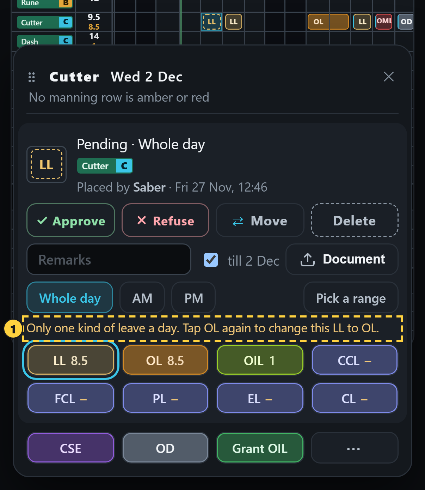</button>
  <figcaption>A: after the first tap on OL, the line above the leave buttons.</figcaption>
</figure>
```
Choices: keep.

**Q4** — title and choices A and B: keep. The example runs long and its last clause explains twice. Replace, and fix the second picture's path (only the clean file exists):
```html
<p><b>Example:</b> Hex (admin) turned Auto-approve off last week. Today he changes Cutter's (member) approved LL to OL. You ruled the result follows his switch, so it goes back to pending. The switch is not on that card, so nothing warns him.</p>
```
`img/s04-B-hidden-phone.png` → `img/s04-B-hidden-clean-phone.png`.
Choice C, shorter and without "or half" (see R1): `<li><b>C: an admin's change always stays approved,</b> whatever his switch says.</li>`

**Q5** — the example said Thu 3 Dec; the pictures are Mon 30 Nov. Replace:
```html
<p><b>Example:</b> Ranger (member) has an approved LL on Mon 30 Nov. Bidding for that day has closed. You ruled a move or change on the Leave War sends his leave back to pending, and nothing pending can go on a closed day.</p>
```
("turns leave back into a bid" was the inside way of saying it; "back to pending" is his own ruling's word, D2922.) Choices: keep A and B; C: `<li><b>C: move and change it as on an open day;</b> it goes back to pending, on a day closed for bidding.</li>` — so the cost of C is in the line. Captions keep.

**Q6** — both picture files do not exist under those names, and the second alt says "Accept" where the picture shows "→ Ground" and "→ Unavail". Replace the example and the pair:
```html
<p><b>Example:</b> Zenith (member) has a Meeting on Monday's Ground Programme. Saber (scheduler), on Edit Schedule, wants it off.</p>
<div class="pair">
  <figure>
    <button class="shot" type="button">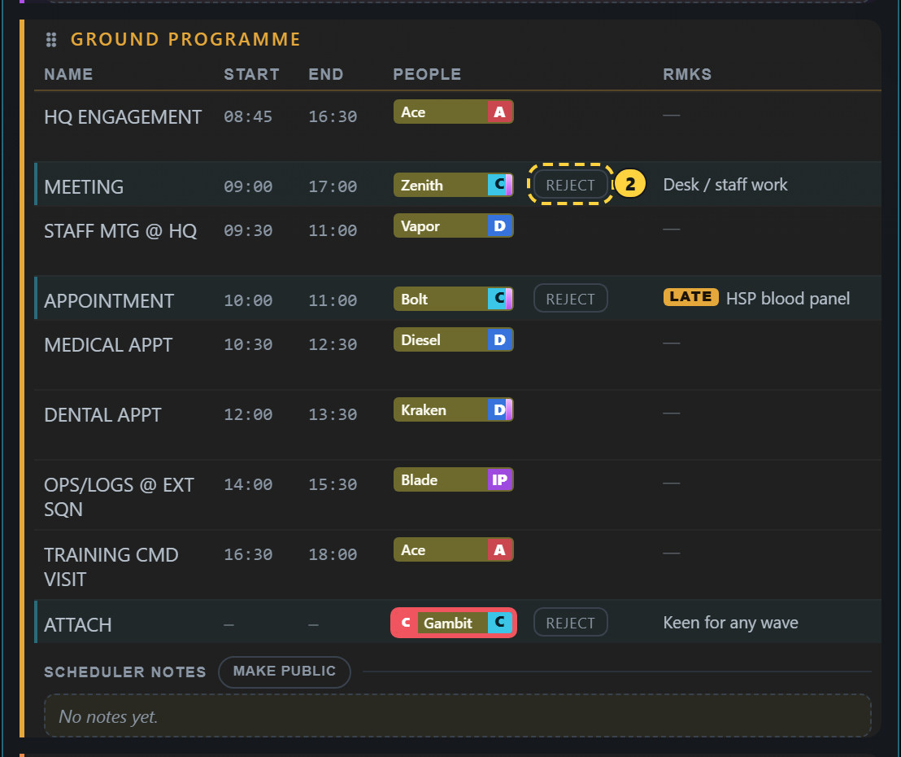</button>
    <figcaption>A: Reject on the row itself.</figcaption>
  </figure>
  <figure>
    <button class="shot" type="button">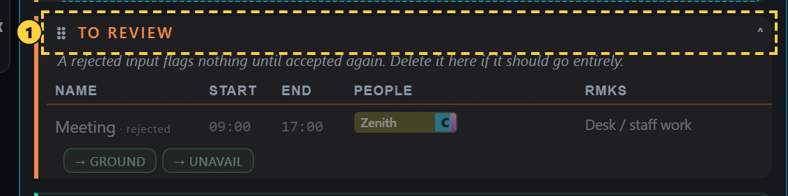</button>
    <figcaption>A: "To review" with the rejected Meeting.</figcaption>
  </figure>
</div>
```
(The host should open `s08-none-ground-desktop.png` to confirm it is the one with the Meeting still on the Ground Programme.) Choices: keep.

**Q7** — the example said Thu 10 Dec; the picture is Tue 8 Dec. And A narrows his own 28 Nov ruling that his approved leave keeps Move (D2898), which the card must say. Replace:
```html
<p><b>Example:</b> Ranger (member) has an approved LL on Tue 8 Dec, 10:00 to 15:00, filed on the Inputs page. He opens it on the Leave War.</p>
<figure>
  <button class="shot" type="button">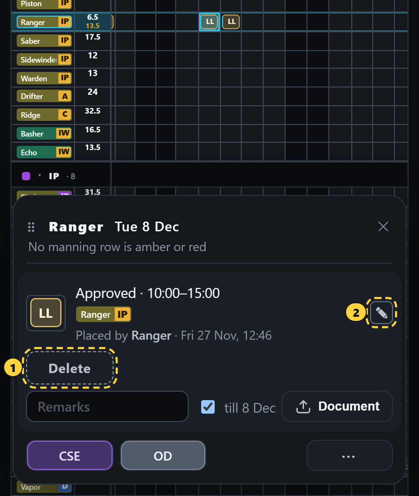</button>
  <figcaption>A: the pencil, Delete, Remarks and Document.</figcaption>
</figure>
<ul class="choice">
  <li><b>A (recommended): no Move, the one exception to your rule that his approved leave keeps Move.</b> A moved leave becomes a whole-day bid and would lose its hours; the pencil changes its days or hours instead.</li>
  <li><b>B: Move too,</b> the moved leave becoming a whole-day bid, pending.</li>
</ul>
```

**Q8** — replace the title, the lead line and the whole pair block (five paths were wrong; Q8a's alt named Cutter and "Wed 16 Dec" where the picture is Ghost and "Wed 16"; Q8c said "until Q1 is built"; s12 added as Q8i):
```html
<h3>Nine more drawings: build them as drawn?</h3>
<p>Your approved drawings did not show these. Reply "Q8 yes", or name the one to change.</p>
<div class="pair">
  <figure><button class="shot" type="button">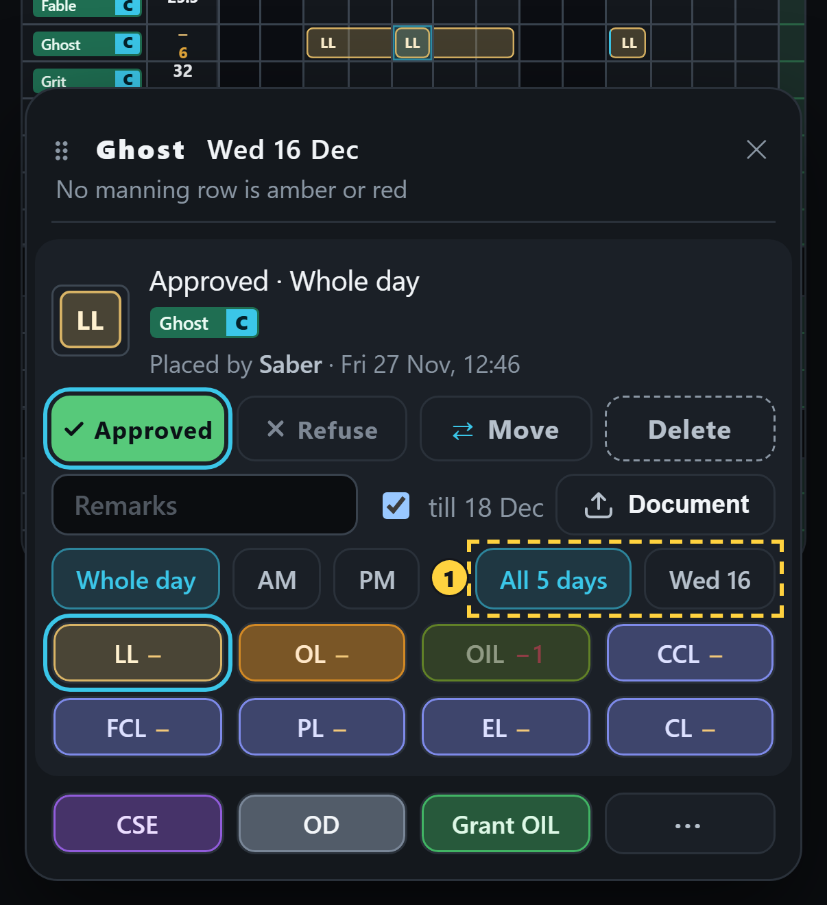</button><figcaption><b>Q8a</b> A leave of several days: "All 5 days" or the day tapped.</figcaption></figure>
  <figure><button class="shot" type="button">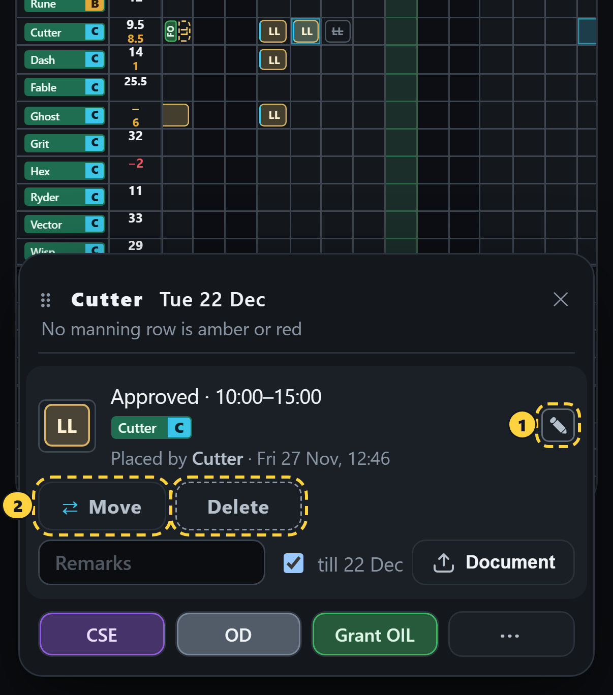</button><figcaption><b>Q8b</b> An admin on leave with set hours: no leave buttons.</figcaption></figure>
  <figure><button class="shot" type="button">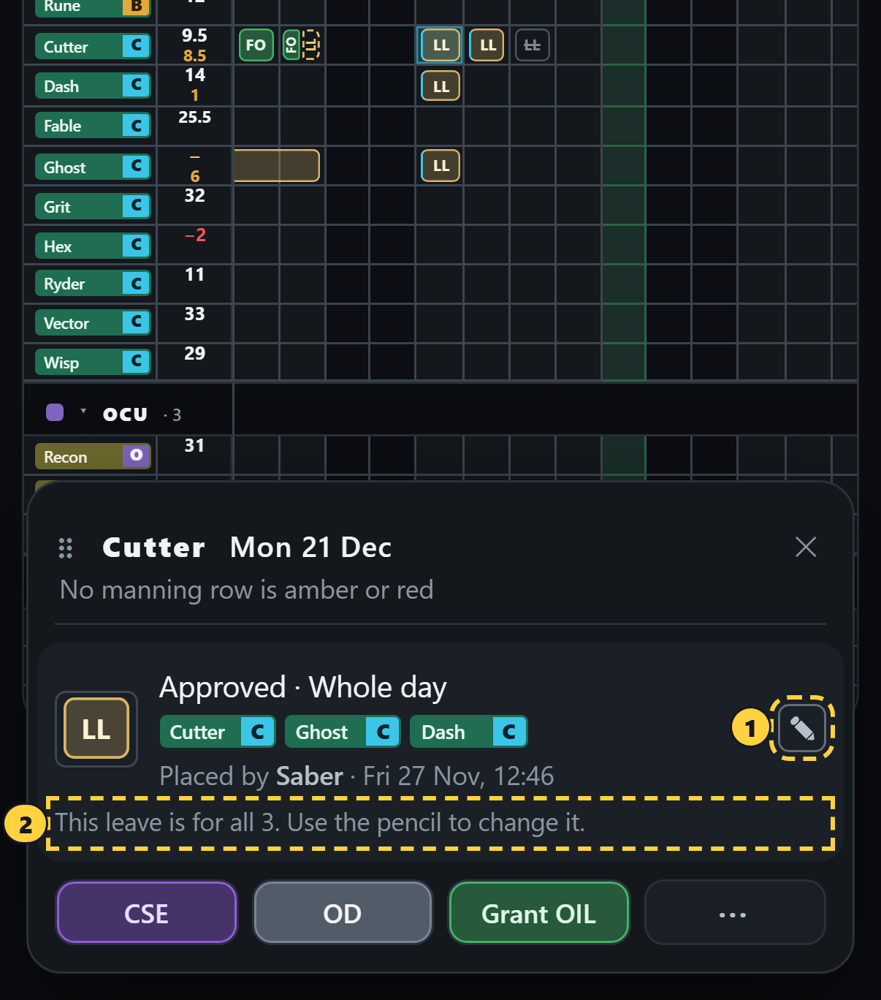</button><figcaption><b>Q8c</b> A group leave until Q1 and Q2 are answered: pucks and pencil.</figcaption></figure>
  <figure><button class="shot" type="button">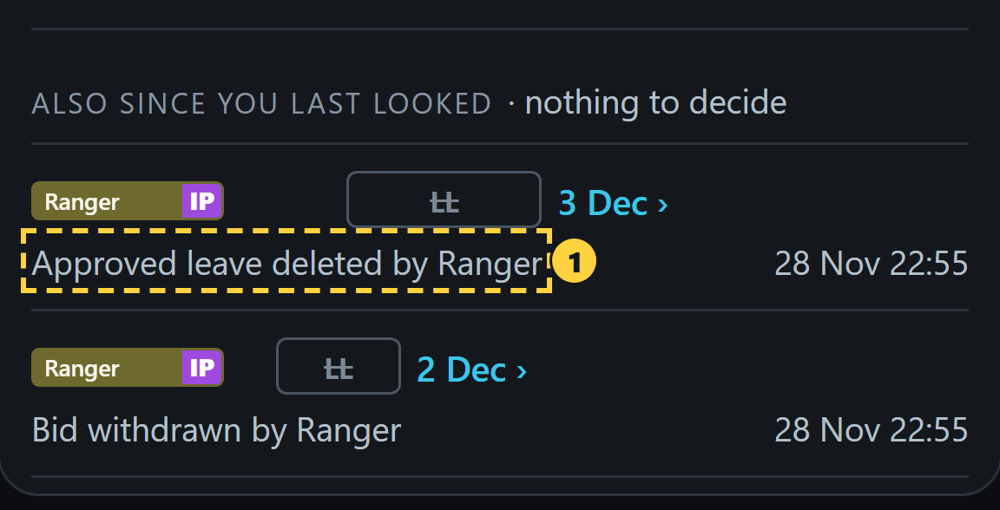</button><figcaption><b>Q8d</b> Approvals: a member deleted his approved leave.</figcaption></figure>
  <figure><button class="shot" type="button">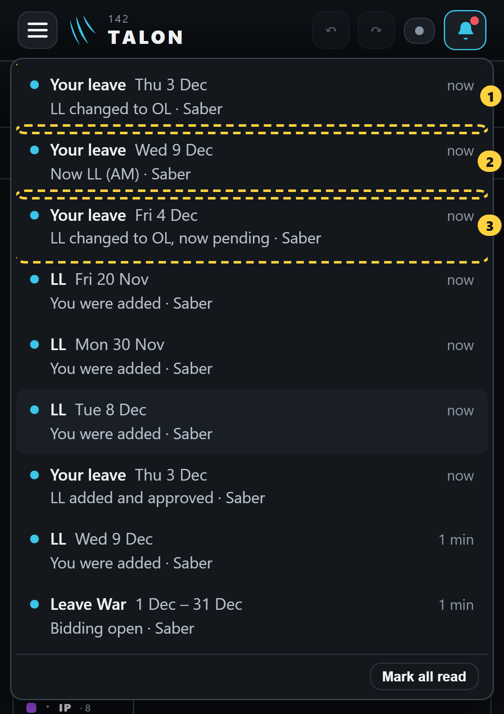</button><figcaption><b>Q8e</b> The bell: an admin changed his leave's kind or half, and when that leaves it pending.</figcaption></figure>
  <figure><button class="shot" type="button">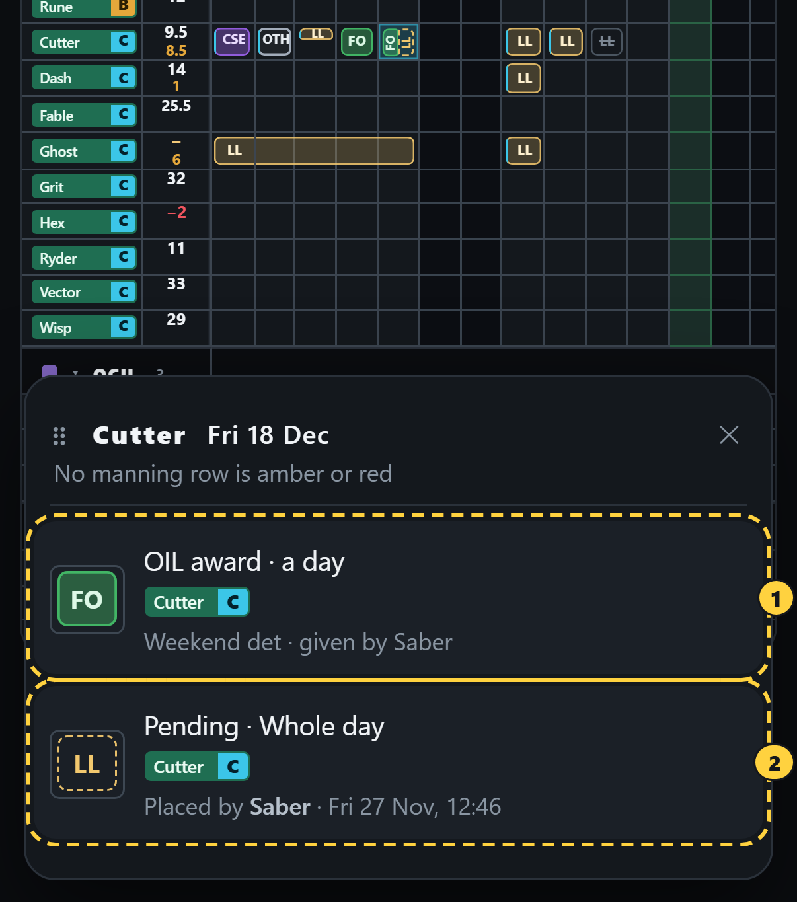</button><figcaption><b>Q8f</b> A member on another man's day: read only.</figcaption></figure>
  <figure><button class="shot" type="button">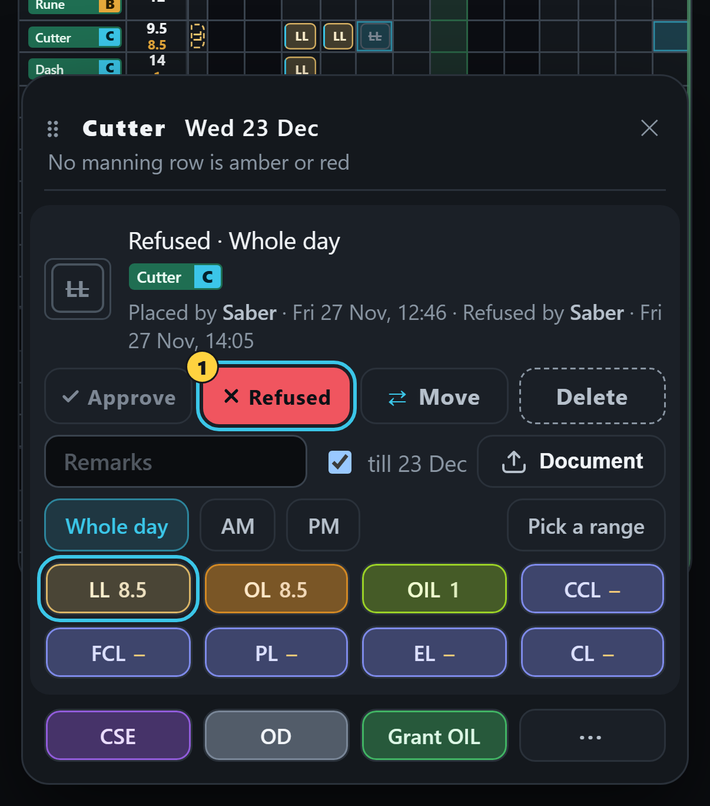</button><figcaption><b>Q8g</b> A refused bid.</figcaption></figure>
  <figure><button class="shot" type="button">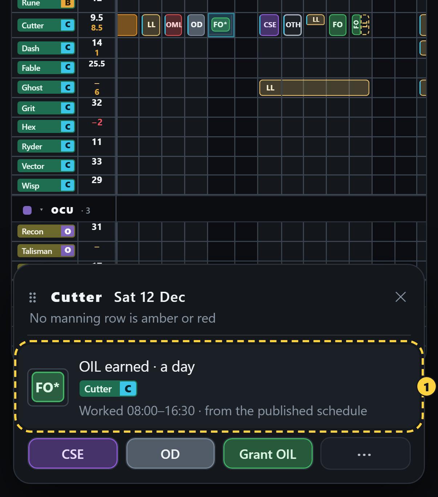</button><figcaption><b>Q8h</b> OIL the schedule earned: no buttons.</figcaption></figure>
  <figure><button class="shot" type="button">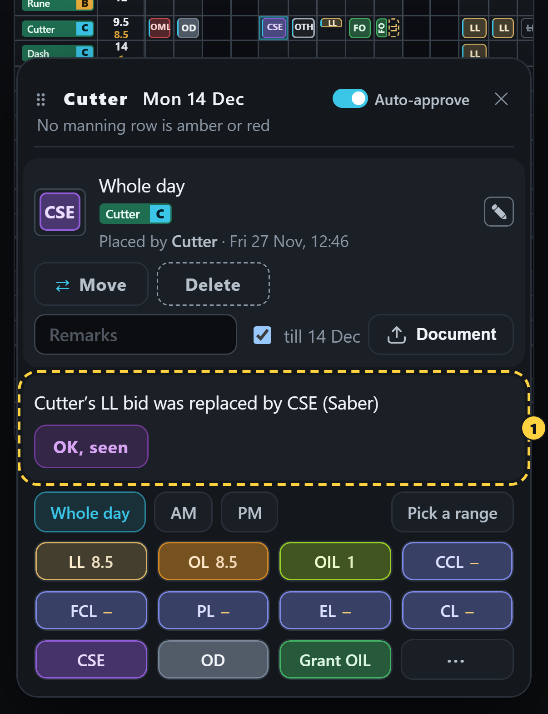</button><figcaption><b>Q8i</b> A bid replaced by a course: the notice, with "OK, seen".</figcaption></figure>
</div>
```
The Q8 pictures must be redrawn with Part A's words (w8, w10pending, w11) before the page goes to him. Each card above can be said back in three lines; Q8 is nine looks under one "as drawn?", which his card shape allows only because each carries its own letter (D2920).

## 3. READINGS — meanings the words would settle that he has not ruled

- **R1. An admin's change of the half (AM / PM) follows his Auto-approve switch.** D2925 rules a swap of kind only. w11's pending form, Q4's old choice C ("kind or half") and the plan's "(or AM)" all assume the half goes the same way. Example: Hex, Auto-approve off, makes Cutter's approved whole-day LL an LL (AM). Reading: it goes back to pending. Not ruled: it could as well stay approved, the day getting shorter, not different.
- **R2. "Only one kind of leave a day" on a half day.** The line states a rule for the day. The reading told to him under D2897 is that a morning leave beside a free afternoon is not "on top". Example: Cutter holds LL (AM); with PM picked, OL is added at once and the day then holds two kinds, which the sentence says cannot be; with AM picked, the line shows and says "this LL", where the Leave War's own form is "LL (AM)" (D1525). The words for a held half are not drawn. Suggested, for his look: `Only one kind of leave at a time. Tap OL again to change this LL (AM) to OL.`
- **R3. "Placed by Ranger" on leave he filed on the Inputs page (s02b).** D2927 rules the form of the line, not that a filing on the Inputs page is called "placed". Example: Ranger files LL 10:00–15:00 on the Inputs page; on the war his card reads "Placed by Ranger · Tue 8 Dec …". He may expect "Filed by".
- **R4. w9 and Q5 send a member to the Inputs page for a past day.** "This day has passed. … change it on the Inputs page." assumes the Inputs page lets him change or delete approved leave on a day already gone. Example: on 28 Nov Ranger opens his LL of Fri 20 Nov and follows the line; if the Inputs page refuses a past day, the line sent him nowhere. The builder checks before it is built; if it refuses, the past-day line says only what he can do here.
- **R5. w8: the pencil's window changes the leave for all three.** Rests on the scheduler's D748 (a shared input's window changes it for everyone). Example: Hex opens the group LL from Cutter's box with the pencil and makes it AM: Ghost and Dash go AM too. True of the Inputs window today; said on the war for the first time.
- **R6. w26: the admins are told when a member deletes his approved leave.** D2922 says only that deleting "simply removes it". The line under "Also since you last looked" is the plan's. Example: Ranger deletes his approved LL of Thu 3 Dec; Saber's Approvals shows "Approved leave deleted by Ranger". Likely wanted (manning changes), not ruled.
- **R7. s11 drops "given by Weekend/PH".** Not a meaning of his, but a fact leaving the screen: put to him as a cut.

## 4. Untrue, as found

1. **Nine picture paths in `body.html` name files that do not exist:** `s13-q3-pending-phone`, `s04-B-hidden-phone`, `s08-reject-desktop`, `s08-waiting-desktop`, `s02b-member-hours-phone`, `s02a-admin-hours-phone`, `s05-group-until-phone`, `s07-bell-phone`, `s09-other-mans-day-phone`. The right names are in Part B. As it stands the page would show nine broken pictures.
2. **Q3's example** says Ranger taps OL on his own bid; the picture is Cutter's day opened by an admin.
3. **Q5's example** says Thu 3 Dec; the pictures are Mon 30 Nov. **Q7's** says Thu 10 Dec; the picture is Tue 8 Dec.
4. **Q6's second alt** says "with Accept"; the row's buttons read "→ Ground" and "→ Unavail".
5. **Q8a's alt** says Cutter and "Wed 16 Dec"; the picture is Ghost and "Wed 16". **Q8** counts eight and leaves out s12. **Q8c** says "until Q1 is built"; the card stands until Q1 and Q2 are answered.
6. **Q1, choice A, "as you ruled on 28 Nov":** D2896 rules which pucks show when "Cutter" or "3 pax" is pressed, not when he leaves the group. And the card did not say that B is the answer he kept after being told both readers recommended the other. The plan's own Q1 text ("which a split at the press would make untrue") overstates it the same way: after a split "3 pax" could not show three, but that is an argument for A, not a ruling.
7. **The "now" list's Q2 title** differs from its card's.
8. **w11, "LL changed to LL (AM)",** is not his ruled bell form for a half day (D2521: "Now LL (AM)").
9. **s08's note, "Delete it here…":** no Delete on the row in the picture.
10. **The plan names the folder `2026-11-29-day-window-more/`;** the work is in `2026-11-28-day-window-more/` (the helper's own note; the plan's line wants correcting).
11. Not checked by me: that Cutter, Ghost and Dash are pilots (the cards said so); that `s08-none-ground-desktop.png` is the frame with Reject on the Meeting's row.
